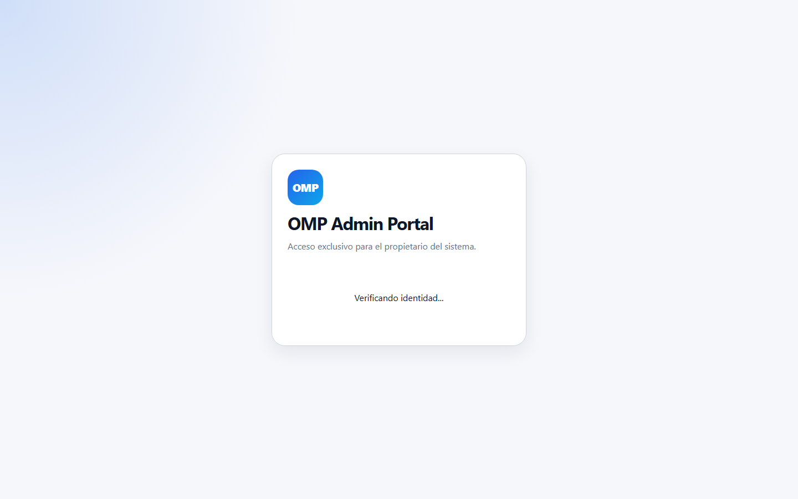
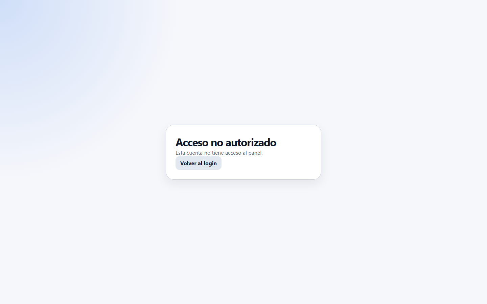

# OMP Admin Portal

Panel administrativo full-stack de OMP. El frontend usa React, TypeScript y Vite;
el backend usa Express y Firebase Admin SDK. La imagen de producción se despliega
en Cloud Run mediante el `Dockerfile` del proyecto.

## Requisitos

- Node.js 22.22 o posterior.
- npm.
- Un proyecto de Firebase configurado.
- Para producción, una cuenta de servicio de Cloud Run con acceso a Firestore y
  Firebase Authentication.

## Variables de entorno

Copia `.env.example` como `.env.local`. Este archivo es local y está ignorado por
Git.

```powershell
Copy-Item .env.example .env.local
```

Variables del frontend:

- `VITE_FIREBASE_API_KEY`
- `VITE_FIREBASE_AUTH_DOMAIN`
- `VITE_FIREBASE_PROJECT_ID`
- `VITE_FIREBASE_STORAGE_BUCKET`
- `VITE_FIREBASE_MESSAGING_SENDER_ID`
- `VITE_FIREBASE_APP_ID`

Variables del servidor:

- `PORT`: puerto de Express; por defecto `3000`.
- `OWNER_EMAILS`: lista de correos (separados por comas) autorizados a entrar
  al panel. Es la única fuente de autorización real. Si está vacía o ausente,
  el servidor rechaza todas las solicitudes (falla cerrado) — nunca la dejes
  sin definir en Cloud Run.
- `ALLOWED_ORIGIN`: origen exacto permitido por CORS para las rutas
  protegidas. En Cloud Run, con el mismo servicio sirviendo frontend y API,
  puede quedar vacío (las llamadas son same-origin). `GET
  /api/congregations/:id/access-check` es la única ruta pública y no depende
  de esta variable, porque la consume la app móvil desde otro origen.
- `FIREBASE_PROJECT_ID`: proyecto usado por Firebase Admin cuando no lo aporta
  automáticamente el entorno.
- `FIREBASE_CLIENT_EMAIL` y `FIREBASE_PRIVATE_KEY`: alternativa exclusiva para
  desarrollo local fuera de gcloud/ADC. La clave privada representa sus saltos
  de línea mediante `\n`. No deben configurarse en Cloud Run.

No guardes claves privadas ni archivos `serviceAccount*.json` en el repositorio.
En Cloud Run se recomienda usar Application Default Credentials mediante la
identidad del servicio, sin variables de clave privada.

## Flujo de inicio de sesión

La pantalla inicial permite elegir una cuenta de Google. El backend acepta la
sesión únicamente cuando el correo está en `OWNER_EMAILS`, está verificado, fue
autenticado por Google y tiene el claim `superAdmin`.



Una cuenta que no cumpla todas las condiciones se envía a la pantalla de acceso
no autorizado sin mostrar información administrativa.



## Desarrollo local

Instala las dependencias:

```bash
npm ci
```

Inicia frontend y backend:

```bash
npm run dev
```

- Frontend: `http://localhost:5174`
- API: `http://localhost:3000/api`

El servidor de Vite redirige las llamadas `/api` al backend local.

## Validación

```bash
npm run validate
npm run build
```

`validate` ejecuta TypeScript, ESLint y las pruebas de contrato (Vitest). El workflow
`.github/workflows/admin-web-validate.yml` ejecuta la misma validación en cada
pull request que modifica `admin-web/`.

## Producción local

```bash
npm run build
npm run start
```

En producción, Express sirve la aplicación compilada desde `dist/` además de la
API.

## Autenticación

El panel no usa Google Cloud IAP: la autenticación es Firebase Auth con
Google Sign-In, restringida a una allowlist de propietarios (`OWNER_EMAILS`)
más un custom claim (`superAdmin`) verificado en cada request por el
middleware `requireOwner`. Un correo en la allowlist sin haber iniciado
sesión con Google no sirve, y un claim sin estar en la allowlist tampoco: se
requieren ambas condiciones. `GET /api/congregations/:id/access-check` sigue
siendo la única ruta pública, para la app móvil.

Configuración única en Firebase Console (no se puede automatizar):

1. **Authentication → Sign-in method** → habilitar el proveedor **Google**.
2. **Authentication → Settings → Authorized domains** → añadir el dominio de
   Cloud Run del servicio (y `localhost` ya viene incluido para desarrollo).

## Despliegue en Cloud Run

Desde `admin-web/`:

```bash
gcloud run deploy omp-admin-portal \
  --source . \
  --region us-central1 \
  --allow-unauthenticated \
  --set-env-vars OWNER_EMAILS=propietario@example.com
```

`--allow-unauthenticated` es correcto aquí: la autorización real ocurre dentro
de la aplicación (`requireOwner`), no en la capa de infraestructura. Define
`OWNER_EMAILS` como variable de entorno del servicio — sin ella, el servidor
rechaza toda la API con `500 OWNER_ALLOWLIST_MISSING`.

La cuenta de servicio de Cloud Run debe contar, como mínimo, con los permisos
equivalentes a `roles/datastore.user` y `roles/firebaseauth.admin`. Firebase Admin
obtendrá las credenciales mediante ADC.

## Recuperación de acceso

El propietario del proyecto de GCP siempre puede recuperar el acceso sin
depender de ningún secreto guardado:

```bash
gcloud auth application-default login
npm run grant:owner -- tu-correo@gmail.com
```

Esto crea el usuario en Firebase Auth si no existe y le concede el custom
claim `superAdmin`. Después, añade ese correo a `OWNER_EMAILS` en el entorno
del servicio (si no estaba ya) y vuelve a iniciar sesión con Google en el
panel — `requireOwner` fuerza un refresco de token la primera vez que detecta
que falta el claim.

Para revocar el acceso de una cuenta comprometida de inmediato:

```ts
await getAuth().revokeRefreshTokens(uid);
```

(el middleware verifica `checkRevoked: true` en cada request, así que las
sesiones activas mueren de inmediato).

## Seguridad de credenciales

Una clave de cuenta de servicio que haya sido publicada debe revocarse, aunque el
archivo se elimine después. Si llegó a Git remoto, también permanece en el
historial hasta que este se limpie. No reutilices una clave expuesta.

## Contrato de planes de facturación

Las claves de plan (`omp_80`/`omp_150`/`omp_250`), sus límites de usuarios y sus
precios en MXN viven en `src/shared/contracts/billing.ts`, copiados
literalmente de `Marcor360/OMP@v1.31.3` (`src/types/billing.ts`). No los
edites a mano sin revisar primero si el principal cambió: el test en
`src/shared/contracts/__tests__/billing.contract.test.ts` (`npm run test`)
congela los valores actuales y falla si divergen sin que nadie se haya dado
cuenta. Tras cada release de OMP que toque `billing.ts`, compara ese archivo
contra el original y actualiza ambos (constantes y test) a la vez.

El servidor escribe el plan en `billing.planKey` + `billing.activeUsersLimit`
+ `billing.userLimit` — los mismos campos que usa el flujo real de Stripe
(`functions/src/billing/stripe/billing-state.ts` en el principal). Nunca en
`plan` (raíz) ni `billing.plan`: esos campos existieron en versiones
anteriores del panel pero el principal nunca los lee.

Si quedan congregaciones con datos del modelo viejo (`plan: 'basico'` etc.),
corrige con:

```bash
npx tsx scripts/migrate-plan-keys.ts        # dry-run: solo reporta
npm run migrate:plan-keys -- --apply        # escribe y registra en adminAuditLogs
```

## Ciclo de vida de la congregación

`lifecycleStatus` (`active | paused | blocked | archived`) es un modelo propio
de este panel — el principal no lo conoce. `isActive` (el único campo que
lee `src/context/user-context.tsx` en OMP directamente vía Firestore, sin
pasar por este panel) **siempre** se deriva de `lifecycleStatus === 'active'`
y se escribe en la misma operación (`PATCH /:id/lifecycle` y el atajo legado
`PATCH /:id/status`, que internamente usa la misma función). Nunca deben
desincronizarse: si algún día se toca esa lógica, hazlo en
`src/server/routes/congregations.routes.ts::applyLifecycleWrite`, el único
punto de escritura.

Transiciones permitidas (`src/server/domain/lifecycle.ts`):

```
active   -> paused, blocked, archived
paused   -> active, blocked, archived
blocked  -> active, paused, archived
archived -> active                      (solo se puede restaurar, no "pausar" algo archivado)
```

Congregaciones existentes sin `lifecycleStatus` (antes de esta fase) se
resuelven al vuelo (`true` → `active`, `false` → `paused`) hasta que corras:

```bash
npm run migrate:lifecycle-status              # dry-run
npm run migrate:lifecycle-status -- --apply
```

## Borrado de congregación — variables de Stripe

`DELETE /api/congregations/:id` exige `{ confirmName }` en el body (debe
coincidir exactamente con el `name` de la congregación) y soporta
`?dryRun=true` para previsualizar el `summary` sin borrar nada.

Si la congregación tiene `billing.stripeSubscriptionId`, el borrado cancela
esa suscripción **antes** de tocar Firestore. Si Stripe falla o
`STRIPE_SECRET_KEY` no está configurada, el borrado se aborta con `409` —
nunca se borra dejando un cobro vivo.

```
STRIPE_SECRET_KEY=sk_live_...   # o sk_test_... en desarrollo
```

Antes de borrar, se guarda un snapshot forense en
`deletedCongregations/{congregationId}` (documento raíz + actor + fecha) —
no es un respaldo completo, pero deja rastro de qué existía. El **PITR de
Firestore (7 días)** sigue siendo el último recurso real de recuperación si
algo sale mal a mitad del borrado en cascada; después de eso, el snapshot en
`deletedCongregations` es lo único que queda.

**Idempotencia:** si el proceso se corta a la mitad (crash, timeout), un
reintento es seguro para las colecciones que se borran por query
(`notifications`, `events`, `cleaningGroups`, subcolecciones) porque
simplemente no encontrarán más documentos que borrar. El único estado
verdaderamente inconsistente posible es: Stripe ya canceló la suscripción
pero Firestore no se terminó de borrar — en ese caso la congregación queda a
medio borrar pero sin cobro activo, que es preferible a la inversa. Vuelve a
llamar al mismo `DELETE` para completarlo.

## Reglas de Firestore

Este repositorio no contiene ni despliega `firestore.rules`. El panel opera con
Firebase Admin SDK, que no evalúa reglas de cliente. La única fuente de verdad de
las reglas está en `rules_src/` del repositorio principal OMP; copiarla aquí crea
una segunda versión que queda obsoleta y podría desplegarse por accidente.
